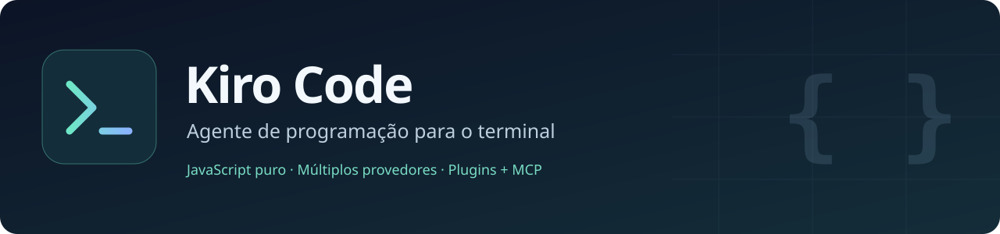

<p align="center">
  
</p>

<p align="center">
  <a href="https://github.com/zerolimites0001-web/kiro-code/actions/workflows/check.yml"></a>
  
  
  <a href="LICENSE"></a>
</p>

**Converse com um modelo de IA e trabalhe no seu projeto sem sair do terminal.**

Kiro Code é um agente de programação em JavaScript puro: conecta um provedor de
IA a ferramentas locais para ler arquivos, editar código, executar comandos e
inspecionar imagens. A interface ANSI mostra respostas em streaming, saída das
ferramentas, diffs e histórico de sessões.

**Você escolhe o provedor e o modelo.** O Kiro Code é o cliente/agente — não um
modelo de IA próprio e não inclui uma assinatura ou créditos de API.

[Começar](#começar) · [Provedores](#provedores) · [Comandos](#comandos) ·
[Plugins](PLUGINS.md) · [MCP](docs/MCP.md) · [Configuração](docs/CONFIGURATION.md) ·
[Segurança](SECURITY.md)

> **Antes de usar:** as ferramentas executam comandos e alteram arquivos com as
> permissões do seu usuário, sem sandbox nem confirmação por ação. Trabalhe com
> controle de versão, revise os diffs e não exponha credenciais desnecessárias.

## O que já está implementado

| Área | Recursos |
| --- | --- |
| **Agente** | Ciclo de chamadas de ferramentas, resultados e continuação da resposta |
| **Terminal** | TUI colorida, streaming, caixas de ferramentas expansíveis e saída de shell ao vivo |
| **Arquivos** | Leitura por intervalo, criação, edição por trecho único e visualização de diffs |
| **Imagens** | `read_image` para PNG, JPG, GIF e WebP, quando o modelo aceita visão |
| **Sessões** | Histórico local, retomada, renomeação, exclusão, backups e diagnóstico |
| **Contexto** | Compactação manual e automática, com backup do histórico anterior |
| **Provedores** | OpenAI-compatíveis, Anthropic; adaptador Google nativo experimental |
| **Modelos** | Listagem/seleção, metadados do endpoint e catálogo models.dev com cache |
| **Extensões** | Plugins locais com aprovação por hash, comandos, ferramentas, eventos e widgets |
| **MCP** | Ferramentas de servidores remotos via Streamable HTTP |
| **Interrupção** | Cancelamento do turno e tentativa de encerrar a árvore de processos de shell |

Não há dependências npm de runtime, mas são necessários **Node.js**, um terminal
interativo e um backend de IA local ou remoto. Serviços externos podem cobrar pelo uso.

## Começar

### 1. Baixe e execute

```sh
git clone https://github.com/zerolimites0001-web/kiro-code.git
cd kiro-code
node bin/kiro.js
```

Não precisa de build nem de `npm install` para rodar diretamente.

Requisitos: **Node.js 18+**, terminal com suporte ANSI e um ambiente com `sh`.
O controle de processos usa mecanismos POSIX; Windows nativo não é uma plataforma
validada. Em Linux/Alpine e Termux, use uma versão atual do Node disponível no sistema.

<details>
<summary><strong>Instalar pré-requisitos no Alpine ou Termux</strong></summary>

Alpine Linux:

```sh
apk add nodejs npm git
```

Termux:

```sh
pkg install nodejs git
```

Os comandos de pacotes dependem das permissões e dos repositórios do seu ambiente.
Não é necessário instalar navegador, Chromium ou ferramentas de build.
</details>

### 2. Configure um provedor

Na primeira inicialização, o assistente de login abre quando não há provedores
configurados. Você também pode chamá-lo com:

```text
/login
```

Escolha o serviço, informe endpoint/chave quando necessário e selecione um modelo
que esteja disponível na sua conta. Depois, envie uma tarefa, por exemplo:

```text
Leia este projeto, explique a estrutura e proponha uma correção para o teste que falha.
```

O agente pode executar ferramentas durante a resposta. Não use instruções como
substituto de uma revisão dos comandos e das mudanças feitas.

### 3. Opcional: habilite o comando `kiro`

Na pasta clonada:

```sh
npm link
```

Depois, abra o diretório em que quer trabalhar:

```sh
cd /caminho/do/seu-projeto
kiro
```

`npm link` precisa de um prefixo npm gravável. Se houver erro de permissão, use a
execução direta por caminho absoluto em vez de elevar os privilégios do agente:

```sh
node /caminho/kiro-code/bin/kiro.js
```

**O diretório atual é a base dos comandos e dos caminhos relativos das ferramentas.**
Não presuma instalação por um pacote publicado no npm: o procedimento documentado
é clonar este repositório.

## Provedores

| Opção no `/login` | Transporte | Observação |
| --- | --- | --- |
| OpenAI | API de chat OpenAI-compatível | Modelos e recursos dependem da conta |
| Anthropic | API Messages nativa | A lista inicial de modelos é definida no código |
| NVIDIA NIM | OpenAI-compatível | Usa o endpoint configurado no preset |
| Ollama local | OpenAI-compatível | Servidor precisa estar iniciado; a chave pode ficar vazia |
| Arena | OpenAI-compatível | Há overrides específicos de metadados no código |
| Google AI Studio | API Gemini nativa | **Experimental: veja a limitação de persistência abaixo** |
| Custom | OpenAI ou Anthropic-compatível | Configure a base URL do seu serviço |

Use `/provider` para trocar de provedor, `/models` para escolher o modelo e
`/mod-provider` para editar configuração, modelos e metadados.

Thinking tem níveis `off`, `minimal`, `low`, `medium`, `high` e `xhigh`; o que
realmente funciona depende do modelo, do teto configurado e da API do provedor.
Visão e tool calling também não são garantidos só por selecionar um preset.

**Limitação atual do Google:** o adaptador nativo existe, mas o formato salvo em
`models.json` não preserva `type: google` e o recarrega como OpenAI-compatível.
Isso pode quebrar o provedor depois de reiniciar. Não trate esse caminho como
suporte estável até corrigir a serialização. IDs presentes em presets também
não garantem que um modelo exista ou esteja disponível na sua conta.

Detalhes de transporte, rede e limites: **[guia de provedores](docs/PROVIDERS.md)**.

## Ferramentas do agente

| Ferramenta | O que faz |
| --- | --- |
| `bash` | Executa um comando usando `sh`, com saída ao vivo e timeout |
| `read_file` | Lê texto, opcionalmente por intervalo de linhas |
| `write_file` | Cria ou sobrescreve um arquivo |
| `edit_file` | Substitui um trecho exato e único, exibindo o diff |
| `read_image` | Envia uma imagem local ao modelo, se houver suporte a visão |
| `loop` | Repete um comando até sucesso ou limite de tentativas |

`bash` é o nome da ferramenta, mas o processo executado é **`sh -c`**, não
necessariamente Bash. Não assuma suporte a sintaxe exclusiva de Bash.

As chamadas retornam resultados ao modelo, que decide se continua. O código atual
**não tem um limite prático baixo de passos por mensagem**: acompanhe o consumo e
interrompa o turno se necessário.

## Comandos

| Comando | Função |
| --- | --- |
| `/help` | Lista comandos internos e os registrados por plugins |
| `/login` | Adiciona/configura um provedor e escolhe o modelo |
| `/provider` | Troca o provedor ativo |
| `/models` | Escolhe o modelo do provedor ativo |
| `/mod-provider` | Edita provedores, endpoints, modelos e metadados |
| `/thinking` | Seleciona o nível de raciocínio |
| `/compact` | Resume o histórico para reduzir contexto, preservando um backup |
| `/resume` | Retoma, renomeia ou apaga uma sessão |
| `/sessions` | Diagnostica arquivos de sessão e tenta recuperar/unificar cópias |
| `/new` | Inicia outra sessão |
| `/clear` | Redesenha a tela/histórico sem apagar a sessão |
| `/instances` | Lista instâncias e seus diretórios |
| `/plugins` | Gerencia plugins, aprovação, ativação e recarregamento |
| `/mcp` | Adiciona ou remove conexões de servidores MCP |
| `/quit` ou `/exit` | Salva o que estiver pendente e encerra |

### Teclado e mouse

| Ação | Atalho |
| --- | --- |
| Enviar / confirmar | Enter |
| Histórico de entrada / navegar menus | ↑ / ↓ |
| Completar caminho no token atual | Tab |
| Alternar thinking | Shift+Tab |
| Expandir/recolher ferramentas | Ctrl+O ou clique em uma caixa |
| Rolar histórico | PgUp / PgDn ou roda do mouse |
| Interromper operação atual | Esc ou Ctrl+C |
| Renomear / apagar sessão dentro de `/resume` | Ctrl+R / Ctrl+D |

Durante uma operação, repetir Esc/Ctrl+C pode forçar o encerramento do turno.
Sem operação em andamento, dois Ctrl+C próximos encerram o programa. Ctrl+D não
é o atalho geral para sair. Mouse e teclas especiais dependem do terminal.

## Sessões, contexto e instâncias

As sessões são compartilhadas por padrão em `~/.kiro/sessions/`. A persistência
usa arquivos temporários, `fsync`, rename e backups `.bak`; há recuperação e
heurísticas para históricos divergentes. **Isso não é merge colaborativo completo**:
evite editar a mesma sessão em várias instâncias ao mesmo tempo e mantenha backups.

A compactação automática é acionada por volta de 85% da janela de contexto
informada/estimada, quando há histórico suficiente. `/compact` usa o modelo para
resumir, portanto pode gerar custo e perder detalhes; o original é guardado antes
da substituição. Metadados incorretos afetam a estimativa de contexto.

Configuração, MCP e estado dos plugins usam um diretório lógico por instância,
normalmente `~/.kiro/instances/pid-<pid>/`. Alguns arquivos globais são herdados
na criação; nem toda alteração é sincronizada entre instâncias.

Para reutilizar uma configuração estável:

```sh
KIRO_INSTANCE=trabalho kiro
```

Para o modo compartilhado, conscientemente:

```sh
KIRO_NO_ISOLATE=1 kiro
```

**[Caminhos de dados, prompts e variáveis de ambiente →](docs/CONFIGURATION.md)**

## Plugins e MCP

São duas formas diferentes de extensão:

- **[Plugins locais](PLUGINS.md):** módulos JavaScript aprovados por hash, com
  comandos slash, ferramentas, eventos e widgets da TUI.
- **[MCP remoto](docs/MCP.md):** conexão HTTP com servidores que expõem ferramentas.

Exemplos em [`examples/plugins/`](examples/plugins/):
[`timer.js`](examples/plugins/timer.js) e
[`agent-kit/`](examples/plugins/agent-kit/).

Plugins rodam no processo do Kiro com os mesmos privilégios do usuário. O campo
`permissions` do manifesto é informativo: não é sandbox nem bloqueio de acesso.
Aprovação por hash detecta alterações para novo carregamento, mas não torna
código desconhecido seguro.

## Rede, privacidade e segurança

- Prompts, trechos de arquivos, saídas de ferramentas e imagens podem ser enviados
  ao provedor/modelo escolhido. Leia os termos e a política desse serviço.
- Chaves de API são salvas localmente em JSON; permissões restritas de arquivo
  não equivalem a criptografia.
- Há consulta a `models.dev` para metadados, com cache e fallback.
- Ollama pode executar inferência local, mas isso não torna automaticamente todo
  o aplicativo livre de requisições externas.
- Não há autenticação OAuth completa no MCP atual, sandbox de shell ou aprovação
  individual obrigatória para cada chamada de ferramenta.

**[Leia os cuidados e limitações → SECURITY.md](SECURITY.md)**

## Estrutura

```text
bin/kiro.js          Entrada do comando
src/app.js          Turnos do agente, comandos e integração da TUI
src/tui.js          Terminal ANSI, entrada, menus, streaming e widgets
src/providers.js    Adaptadores de IA e política de retry
src/tools.js        Ferramentas locais e registro dinâmico
src/store.js        Configuração, sessões, backups e prompts
src/instance.js     Diretórios e identidade das instâncias
src/meta.js         Metadados de modelos e catálogo models.dev
src/plugins.js      Loader, aprovação e API de plugins
src/mcp.js          Cliente de ferramentas MCP via HTTP
examples/plugins/   Plugins de exemplo
scripts/check.mjs   Verificação de sintaxe sem executar o agente
docs/               Guias e arte do README
```

## Verificação e contribuição

```sh
npm run check
```

Esse comando verifica a **sintaxe** dos módulos sem importar o aplicativo, acessar
sua configuração, iniciar a TUI ou chamar uma API de IA. A CI faz essa verificação
em Node 18, 22 e 24. Isso não é uma suíte de testes funcionais ou garantia de
compatibilidade com todos os modelos e terminais.

Ainda não há uma suíte automatizada completa de comportamento neste repositório.
Para mudanças funcionais, teste manualmente com dados isolados. Veja
**[CONTRIBUTING.md](CONTRIBUTING.md)**.

## Licença

[MIT](LICENSE), em conformidade com a licença declarada no `package.json`.
Os serviços e modelos configurados pelo usuário têm seus próprios termos.
